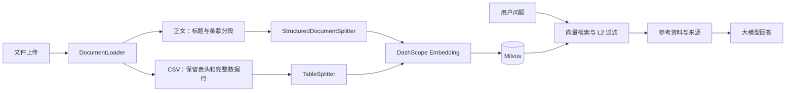

# My_Rag · 企业级知识库问答


一个用于学习和演示的 RAG 项目：上传业务文档，将文本与 CSV 表格切分后写入 Milvus，再检索参考资料并生成带来源的回答。提供 Vue 网页界面、向量管理和问答现场记录，方便检查入库与检索过程。

示例制度为虚构测试资料。当前版本以本地开发为主；本文描述仓库中已实现的功能。

[快速开始](#快速开始) · [文档处理](#文档处理) · [测试与离线预览](#测试与离线预览) · [当前边界](#当前边界) · [项目文档](docs/README.md)

## 已实现的功能

| 功能 | 当前行为 |
| --- | --- |
| 文档入库 | 上传 PDF、DOCX、TXT、CSV；多文件选择后逐个处理，失败文件保留并可重试 |
| 集合管理 | 在“查看入库向量”中选择已有 Milvus 集合，并同步上传与问答使用的集合 |
| 向量查看 | 分页查看文本、来源、维度，打开正文、元数据和向量详情 |
| 向量删除 | 单条删除，或勾选当前页的多条记录后删除 |
| 语义检索 | Top-K 检索与 L2 最大距离过滤；`/search` 不调用回答大模型，仍需查询向量化 |
| 知识库问答 | 根据保留的参考资料回答；没有通过过滤的资料时直接返回缺少依据，不调用大模型 |
| 排查记录 | 每次问答生成 `request_id`，保存候选、距离、过滤结果、实际消息和回答 |

## 处理流程



`vector_db_manager.py` 串联加载、切分、向量化和存储；`vector_retriever.py` 负责检索过滤、参考资料拼装和问答。

## 文档处理

| 格式 | 解析与切分 | 边界 |
| --- | --- | --- |
| TXT / 文字版 PDF | 识别编号章节、条款和 Markdown 标题；长正文用 500 字符、50 字符目标重叠兜底 | PDF 使用 PyPDFium2 原生文字层；不恢复复杂版面 |
| DOCX | Docx2txt 提取文字后进入统一文本切分 | 未读取 Word 标题样式，未单独还原表格与图片 |
| CSV | pandas 按字符串读取，按完整行组成 Markdown 表格块，每块重复表头 | 超长单行完整保留并标记 `oversized`；表格不采用普通字符重叠切分 |
| XLSX / XLS | 已有 UnstructuredExcelLoader 入口 | 依赖尚未纳入核心安装清单，未验证；尚未接入 CSV 的统一表格切分 |

文本片段保留 `document_id`、标题路径、条款、`section_id`、`chunk_id` 等元数据。CSV 表格额外保留 `table_id`、`row_start`、`row_end`；行范围从第一条数据记录开始计数，不包含表头。

## 快速开始

以下指令使用 Windows PowerShell，安装和后端启动都从项目根目录执行。

### 1. 准备环境

- Python 3.12（本机验证版本为 3.12.5）。
- Node.js 满足 `^20.19.0 || >=22.12.0`，详见前端 `package.json`。
- 可连接的 Milvus 服务；已验证版本为 3.0.2，默认地址 `127.0.0.1:19530`。
- 可调用项目所用 Embedding 和聊天模型的 DashScope API Key。

Milvus 需要单独启动；当前仓库没有 Docker Compose 文件。已有容器可在 Docker Desktop 中启动，需要安装时参照 [Milvus 官方 Windows 指南](https://milvus.io/docs/install_standalone-windows.md)。

### 2. 安装后端并填写配置

```powershell
python -m venv .venv
& .\.venv\Scripts\python.exe -m pip install -r backend\requirements.txt

if (-not (Test-Path .env)) {
    Copy-Item configs\.env.example .env
}
```

打开**项目根目录 `.env`**，填写 `DASHSCOPE_API_KEY`，按需修改 Milvus 地址。后端实际读取 `<项目目录>/.env`；`configs/.env.example` 是共享模板，`configs/.env` 不会被当前后端自动读取。

Docker 的映射若为 `19531:19530`，应设置 `MILVUS_PORT=19531`：项目连接的是宿主机端口。并行升级时可使用此映射，避免与原来的 19530 端口冲突；详见 [Milvus 启动说明](infra/README.md)。

默认配置使用 `text-embedding-v1`、`qwen-plus` 和集合 `agent_rag`。`L2_MAX_DISTANCE=14000` 是当前实验值，需结合所用模型和语料评估；L2 越小表示向量越接近。

### 3. 启动后端

```powershell
& .\.venv\Scripts\python.exe -m backend.app.server
```

默认地址：`http://127.0.0.1:5000`。看到 Flask 启动后，还需确认日志显示向量系统初始化成功。

### 4. 启动前端

另开一个终端，从项目根目录执行：

```powershell
Set-Location frontend\rag_front
npm ci
npm run dev
```

打开终端输出的 Local 地址，通常为 `http://localhost:5173`。

当前前端 API 地址固定为 `http://localhost:5000/api/vector`；修改后端端口时，需要同步调整 `RagChat.vue` 中的 `API_BASE`。

### 5. 完成一次演示

1. 集合名称填写 `bank_rag_v2`，上传仓库内的 `docs/examples/bank_structure_demo.txt` 或 `data/samples/bank_table_demo.csv`。
2. 点击“立即解析入库”，再打开“查看入库向量”，检查正文和元数据。
3. 对 CSV 示例提问“办理大额转账需要什么要求？”；对条款示例提问“哪些情况下应暂停办理相关业务并提交人工复核？”
4. 从后端终端日志获取 `request_id`，或使用 API 返回的请求标识，查看 `logs/rag_traces/` 中的对应文件，对照候选、过滤结果和实际参考资料。

新建集合支持动态元数据；旧集合的字段不兼容时，请使用新集合名，系统不会自动删除旧集合。

## 测试与离线预览

无需 Milvus、API Key 或大模型即可检查样例的加载与切分：

```powershell
& .\.venv\Scripts\python.exe -m scripts.preview_document data\samples\bank_table_demo.csv
```

结果保存到 `logs/document_preview.json`。也可以将文件路径替换为 `docs/examples/bank_structure_demo.txt`。

后端自动测试使用模拟数据库和模型，从项目根目录执行：

```powershell
& .\.venv\Scripts\python.exe -m unittest discover -s backend/tests -p "test_*.py" -v
```

其中无文本 PDF 等异常用例会输出预期错误日志，以最终测试结果为准。`milvus_create.py`、`milvus_inspect.py`、`milvus_search.py` 是历史手工实验，不属于上述自动测试。

前端测试与构建，在 `frontend/rag_front/` 中执行：

```powershell
node --test tests/upload_queue.test.mjs
npm run build
```

这些检查覆盖离线行为与前端构建；真实 Milvus 和模型的完整链路需要另行运行网页演示验证。

## 常用 API

统一前缀：`/api/vector`。

| 方法 | 路径 | 用途 |
| --- | --- | --- |
| POST | `/upload_file` | 上传一个文件；网页多文件上传会逐个调用 |
| POST | `/search` | 检索与距离过滤，不生成回答 |
| POST | `/query` | 知识库问答，返回请求标识 |
| GET | `/collections` | 列出已有集合 |
| GET | `/collection_info` | 查看指定集合信息 |
| GET | `/vectors` | 分页查看入库记录 |
| DELETE | `/vectors/<vector_id>` | 删除指定集合中的一条记录 |
| POST | `/vectors/batch_delete` | 删除指定集合中的多条记录 |

单独测试检索，在已启动后端并上传样例后执行：

```powershell
$body = @{
    query = "办理大额转账需要什么要求"
    collection_name = "bank_rag_v2"
    k = 5
} | ConvertTo-Json

$result = Invoke-RestMethod `
    -Uri "http://127.0.0.1:5000/api/vector/search" `
    -Method Post `
    -ContentType "application/json; charset=utf-8" `
    -Body ([System.Text.Encoding]::UTF8.GetBytes($body))

$result | ConvertTo-Json -Depth 10
```

返回的 `score` 是 L2 距离，不是百分比相似度。

## 项目结构

```text
My_Rag/
├── backend/
│   ├── app/                 # Flask、文档加载与切分、Milvus、检索问答
│   ├── tests/               # test_*.py 自动测试与历史手工实验
│   └── requirements.txt     # 固定直接依赖版本
├── frontend/rag_front/      # Vue 界面、上传队列测试与 npm 锁文件
├── configs/.env.example     # 配置模板，复制到根目录 .env
├── data/samples/            # 可公开的开发样例
├── docs/                    # 当前文档、条款样例与发布整理建议
├── scripts/                 # 离线预览入口及历史独立脚本
├── infra/                   # Milvus 启动说明
├── prompts/                 # 当前 Prompt 位置说明
├── .editorconfig            # 编辑器格式约定
├── .gitattributes           # 跨平台换行约定
└── .gitignore               # 本地环境、生成文件和运行数据的忽略规则
```

`.venv/`、`node_modules/`、`dist/`、实际 `.env`、运行日志、业务文件和数据库数据卷留在本地。依赖清单、`package-lock.json`、配置示例、测试和虚构样例应提交到 GitHub。

## 当前边界

- 尚未实现 OCR、图片内容识别、多栏阅读顺序恢复、PDF 表格还原及页眉页脚过滤。PDF 遇到空文字页会拒绝入库，正常空白页也可能触发；混合 PDF 的图片文字可能遗漏。
- CSV 已完成表格分块；Word、Excel、PDF 表格尚未统一处理。
- 重复上传会追加记录；稳定的内容 ID 不代表已经实现去重。
- 当前距离阈值来自实验，尚无独立标注集上的 Top-K 命中率结果；返回的 `confidence` 也不是经过校准的答案可信概率。
- `scripts/` 中的旧上传、问答脚本使用独立逻辑，不是当前网页链路。`delete_collection.py` 会直接删除硬编码集合，不作为推荐入口。
- 旧清空集合接口、包内旧工厂函数和元数据过滤参数仍有待整理，详见 [GitHub 整理说明](docs/github_readiness.md)。

进一步说明：[文档结构与切分](docs/document_structure_learning.md) · [问答现场排查](docs/rag_debugging.md) · [Milvus 启动](infra/README.md)。


