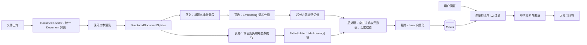

# My_Rag · 企业级知识库问答


一个用于学习和演示的 RAG 项目：上传业务文档，将正文与表格统一解析、切分后写入 Milvus，再检索参考资料并生成带来源的回答。提供 Vue 网页界面、向量管理和问答现场记录，方便检查入库与检索过程。

示例制度为虚构测试资料。当前版本以本地开发为主；本文描述仓库中已实现的功能。

[快速开始](#快速开始) · [文档处理](#文档处理) · [测试与离线预览](#测试与离线预览) · [当前边界](#当前边界) · [项目文档](docs/README.md)

## 已实现的功能

| 功能 | 当前行为 |
| --- | --- |
| 文档入库 | 上传 PDF、DOCX、TXT、CSV、XLSX、XLS；多文件选择后逐个处理，失败文件保留并可重试 |
| 正文切分 | 按标题、条款组织结构段，可选相邻文本单元的语义分组，超长内容递归切分 |
| 片段校验 | 跳过空白 chunk，检查必需标识、片段序号及长度；超长完整表格行需显式标记 |
| 集合管理 | 在“查看入库向量”中选择已有 Milvus 集合，并同步上传与问答使用的集合 |
| 向量查看 | 分页查看文本、来源、维度，打开正文、元数据和向量详情 |
| 向量删除 | 单条删除，或勾选当前页的多条记录后删除 |
| 语义检索 | Top-K 检索与 L2 最大距离过滤；`/search` 不调用回答大模型，仍需查询向量化 |
| 知识库问答 | 根据保留的参考资料回答；没有通过过滤的资料时直接返回缺少依据，不调用大模型 |
| 排查记录 | 每次问答生成 `request_id`，保存候选、距离、过滤结果、实际消息和回答 |

## 处理流程



`vector_db_manager.py` 串联加载、切分、向量化和存储；`vector_retriever.py` 负责检索过滤、参考资料拼装和问答。

## 文档处理

各格式分别解析，统一封装为 LangChain `Document`，再生成用于检索的 chunk。`page_content` 保存正文或表格的文本表示，`metadata` 保存来源与已识别的结构信息；离线预览 JSON 中的 `content` 对应 `page_content`。

| 格式 | 初始封装方式 | 解析规则 |
| --- | --- | --- |
| TXT | 整份文件封装为一个正文 `Document` | 按指定编码读取，进入统一正文切分 |
| PDF | 逐页处理；连续正文与独立表格按阅读顺序分别封装 | PyMuPDF 提取文字与坐标，按需补充 OCR；pdfplumber 提取普通有框表格 |
| DOCX | 按原文顺序，分别封装非空段落和普通表格 | python-docx 读取正文与 Heading 1–6 标题样式；标题转成 Markdown 标记，表格保留表头及数据行 |
| CSV | 整张表封装为一个表格 `Document` | pandas 按字符串读取，保留空值与原始字符串编号，首行为表头 |
| XLSX / XLS | 每个有数据记录的工作表封装为一个表格 `Document` | pandas 配合 openpyxl / xlrd 读取，保留工作表名；首行为表头，跳过空工作表及仅有表头的工作表 |

初始封装粒度不等于最终 chunk 粒度：Word 相邻段落会继续按章节组织，PDF 正文也可以在同一结构分段内跨页累计；表格会结束当前正文分段，单独进入表格切分。

### 正文与表格切分

- **结构分段**：识别显式编号章节、条款和 Markdown 标题，按文档、标题、条款和表格边界组织正文。没有可识别标题的正文仍可进入后续切分；纯标题段不单独生成检索片段。
- **可选语义分组**：在同一结构段内，按中文句末标点和空行划分文本单元，调用 Embedding 后计算相邻单元的余弦相似度；低于阈值时开启新组。分组保留原文顺序，不跨结构段合并。长度预算内的完整条款优先保留；含明确代码、列表、公式标记的段落保守跳过语义分组，仍执行长度兜底。
- **长度兜底**：默认最终正文 chunk 上限为 500 字符，包含拼接的标题路径；超长内容使用 `RecursiveCharacterTextSplitter`，优先沿段落、换行和标点切分。默认目标重叠为 50 字符，仅作用于递归切分，不在独立语义组之间额外制造重叠。这里按字符数计量，不是 Token 数。
- **失败回退**：语义调用或分组异常会记录警告，并回退到结构分段后的长度兜底。关闭语义切分时直接采用结构分段与长度兜底。
- **表格**：CSV、Excel、Word 和 PDF 中已提取的表格统一交给 `TableSplitter`，生成 Markdown。短表完整保留，长表按完整数据行分块；每块重复表头及已有的表格标题、注释。单元格换行转为 `<br>`，单元格内的竖线转为 `&#124;`。
- **超长表格行**：单行加上表头和上下文已超过长度预算时，完整保留并标记 `oversized=True`，不截断单元格；表格不采用普通正文的字符重叠切分。

表头与二维数据行暂存在 `metadata["table_data"]` 中供表格切分使用；生成最终 chunk 时移除该临时字段。

### 切分后处理

`postprocess_chunks()` 在正文与表格切分完成后统一执行：跳过纯空白片段；检查 `document_id`、`section_id`、`chunk_id`、`splitter_version` 为非空字符串，`chunk_index` 为非负整数；拒绝超长正文，超长表格必须带有 `oversized=True`。该步骤不改写有效正文，也不执行相似片段合并或内容去重。

网页入库链路中，文件未生成有效片段时会报错，避免空白文件或仅有标题的文件被当作成功入库。

### 来源与结构信息

片段保留 `source`、`file_type`、`file_name`、`document_id`、已识别的 `heading_path`、`article`、`section_id`、`chunk_index`、`chunk_id` 等信息。

- `document_id` 根据原文件内容生成；`section_id` 标识一次结构分段，不能直接当作整章的统一编号；`chunk_index` 在各结构分段内从 0 开始。
- 网页上传时，`source` 和 `file_name` 使用传入的文件名，避免把每次上传生成的临时目录作为展示来源；离线加载保留传入路径。来源标签一致不代表已经实现重复上传去重。
- `splitter_version` 记录实际切分路径：正文为 `structure-v2`，成功执行语义分组时为 `semantic-v1`，表格为 `table-v1`。`semantic-v1` 片段仍可能经过超长递归切分；可结合日志判断是否发生回退。
- PDF 保留来源页码；跨页正文分段记录 `page_start`、`page_end`，递归生成的子片段继承该范围，尚未细化为每个子片段的精确页码。跨页正文的 `extraction_method` 当前继承首段记录。
- 表格额外保留 `table_id`、`row_start`、`row_end`、`oversized`，Excel 还保留 `sheet_name`。行范围从第一条数据记录开始按 1 计数，不包含表头。

### PDF 解析与 OCR

- **文字与版面**：优先抽取原生文字，依据文本块坐标恢复典型双栏的阅读顺序；按跨页重复频率和位置保守过滤页眉页脚，保护章节标题、表题、注释等内容。
- **表格**：提取普通有框表格，将表内文字从正文中分离，并尝试关联同页近邻的显式表格标题和必要注释，再进入统一 Markdown 表格切分。
- **扫描页**：没有原生文字时执行整页 OCR；混合页保留可读文字层，补充其他区域的图片文字。混合 OCR 在内存副本上遮盖已有可读文字的位置，减少同位置内容被重复识别。
- **异常处理**：缺少 OCR 语言文件、OCR 未识别到有效文字、表格结构需复核等情况会明确报错；含表格的旋转或裁剪页面因坐标尚未适配，也会拒绝继续解析。

OCR 使用中英文语言文件。运行前需将 `chi_sim.traineddata` 和 `eng.traineddata` 放入项目根目录的 `models/tessdata/`；该目录已被 `.gitignore` 排除，克隆仓库后需自行准备。语言文件可从 [Tesseract tessdata_fast](https://github.com/tesseract-ocr/tessdata_fast) 获取。

## 快速开始

以下指令使用 Windows PowerShell，安装和后端启动都从项目根目录执行。

### 1. 准备环境

- Python 3.12（本机验证版本为 3.12.5）。
- Node.js 满足 `^20.19.0 || >=22.12.0`，详见前端 `package.json`。
- 可连接的 Milvus 服务；已验证版本为 3.0.2，默认地址 `127.0.0.1:19530`。
- 可调用项目所用 Embedding 和聊天模型的 DashScope API Key。

Milvus 需要单独启动；当前仓库没有 Docker Compose 文件。已有容器可在 Docker Desktop 中启动，需要安装时参照 [Milvus 官方 Windows 指南](https://milvus.io/docs/install_standalone-windows.md)。

### 2. 安装后端并填写配置

```powershell
python -m venv .venv
& .\.venv\Scripts\python.exe -m pip install -r backend\requirements.txt

if (-not (Test-Path .env)) {
    Copy-Item configs\.env.example .env
}
```

打开**项目根目录 `.env`**，填写 `DASHSCOPE_API_KEY`，按需修改 Milvus 地址。后端实际读取 `<项目目录>/.env`；`configs/.env.example` 是共享模板，`configs/.env` 不会被当前后端自动读取。

Docker 的映射若为 `19531:19530`，应设置 `MILVUS_PORT=19531`：项目连接的是宿主机端口。并行升级时可使用此映射，避免与原来的 19530 端口冲突；详见 [Milvus 启动说明](infra/README.md)。

默认配置使用 `text-embedding-v1`、`qwen-plus` 和集合 `agent_rag`。`L2_MAX_DISTANCE=14000` 是当前实验值，需结合所用模型和语料评估；L2 越小表示向量越接近。

正文语义切分默认关闭。如需启用，在项目根目录 `.env` 中设置以下配置，并重启后端：

```dotenv
SEMANTIC_SPLIT_ENABLED=true
SEMANTIC_SIMILARITY_THRESHOLD=0.45
```

`0.45` 仅为配置示例，需结合自己的语料和 Embedding 模型调整。启用时必须提供 -1 到 1 之间的有限阈值；阈值越高，通常越容易产生新的语义组。语义切分复用入库链路的 Embedding 实例，但文本单元向量化和最终 chunk 向量化是两次处理，会增加调用量。切分阶段使用余弦相似度，不代表 Milvus 检索已从 L2 改成余弦。

修改切分配置只影响后续处理，已有向量不会自动更新。更换 Embedding 模型时，应在独立集合中重新生成文档向量，并使用匹配的模型进行查询；目前配置模板仍使用 v1，尚未默认切换为 v4。

### 3. 启动后端

```powershell
& .\.venv\Scripts\python.exe -m backend.app.server
```

默认地址：`http://127.0.0.1:5000`。看到 Flask 启动后，还需确认日志显示向量系统初始化成功。

### 4. 启动前端

另开一个终端，从项目根目录执行：

```powershell
Set-Location frontend\rag_front
npm ci
npm run dev
```

打开终端输出的 Local 地址，通常为 `http://localhost:5173`。

当前前端 API 地址固定为 `http://localhost:5000/api/vector`；修改后端端口时，需要同步调整 `RagChat.vue` 中的 `API_BASE`。

### 5. 完成一次演示

1. 集合名称填写 `bank_rag_v2`，上传仓库内的 `docs/examples/bank_structure_demo.txt`，或自行准备的本地文档。`data/` 整个目录保留在本地，不随仓库提交。
2. 点击“立即解析入库”，再打开“查看入库向量”，检查正文和元数据。
3. 对条款示例提问“哪些情况下应暂停办理相关业务并提交人工复核？”；使用自备文档时，围绕其中实际内容提问。
4. 从后端终端日志获取 `request_id`，或使用 API 返回的请求标识，查看 `logs/rag_traces/` 中的对应文件，对照候选、过滤结果和实际参考资料。

新建集合支持动态元数据；旧集合的字段不兼容时，请使用新集合名，系统不会自动删除旧集合。

## 测试与离线预览

默认预览不调用 Embedding，无需 Milvus 或 API Key 即可检查样例的加载与结构切分；涉及 OCR 的 PDF 仍需准备语言文件：

```powershell
& .\.venv\Scripts\python.exe -m scripts.preview_document docs\examples\bank_structure_demo.txt
```

结果保存到 `logs/document_preview.json`。也可以将文件路径替换为自行准备的本地文档；`data/` 中的样例不随仓库提供。

预览真实语义切分时，需在根目录 `.env` 中配置 API Key 和 `EMBEDDING_MODEL`，显式传入 `--semantic` 与 `--threshold`：

```powershell
& .\.venv\Scripts\python.exe -m scripts.preview_document docs\examples\bank_structure_demo.txt --semantic --threshold 0.45
```

结果默认保存到 `logs/document_semantic_preview.json`，可用 `--output` 指定其他路径。该模式在正文需要语义分组时调用真实 Embedding 并产生计费 Token，不连接 Milvus 或写入向量库；若样例仅含短条款或表格，可能不会触发语义调用，可查看输出的 `splitter_version` 计数。预览模式由命令行参数控制，不会自动跟随 `.env` 中的 `SEMANTIC_SPLIT_ENABLED`。

若要单独观察相邻句子的相似度及分组，可运行内置的转账、贷款主题示例：

```powershell
& .\.venv\Scripts\python.exe -m scripts.preview_semantic_split --threshold 0.45
```

该命令同样调用真实 Embedding，输出相邻相似度和分组，结果保存到 `logs/semantic_preview.json`。

后端自动测试使用模拟数据库和模型。部分 PDF、Word 用例依赖本地 `data/samples/` 样例，完整测试前需自行准备这些文件；缺少样例时，相关用例会报错。从项目根目录执行：

```powershell
& .\.venv\Scripts\python.exe -m unittest discover -s backend/tests -p "test_*.py" -v
```

其中无文本 PDF 等异常用例会输出预期错误日志，以最终测试结果为准。`milvus_create.py`、`milvus_inspect.py`、`milvus_search.py` 是历史手工实验，不属于上述自动测试。

前端测试与构建，在 `frontend/rag_front/` 中执行：

```powershell
node --test tests/upload_queue.test.mjs
npm run build
```

这些检查覆盖离线行为与前端构建；真实 Milvus 和模型的完整链路需要另行运行网页演示验证。

## 常用 API

统一前缀：`/api/vector`。

| 方法 | 路径 | 用途 |
| --- | --- | --- |
| POST | `/upload_file` | 上传一个文件；网页多文件上传会逐个调用 |
| POST | `/search` | 检索与距离过滤，不生成回答 |
| POST | `/query` | 知识库问答，返回请求标识 |
| GET | `/collections` | 列出已有集合 |
| GET | `/collection_info` | 查看指定集合信息 |
| GET | `/vectors` | 分页查看入库记录 |
| DELETE | `/vectors/<vector_id>` | 删除指定集合中的一条记录 |
| POST | `/vectors/batch_delete` | 删除指定集合中的多条记录 |

单独测试检索，在已启动后端并上传样例后执行：

```powershell
$body = @{
    query = "办理大额转账需要什么要求"
    collection_name = "bank_rag_v2"
    k = 5
} | ConvertTo-Json

$result = Invoke-RestMethod `
    -Uri "http://127.0.0.1:5000/api/vector/search" `
    -Method Post `
    -ContentType "application/json; charset=utf-8" `
    -Body ([System.Text.Encoding]::UTF8.GetBytes($body))

$result | ConvertTo-Json -Depth 10
```

返回的 `score` 是 L2 距离，不是百分比相似度。

## 项目结构

```text
My_Rag/
├── backend/
│   ├── app/                 # Flask、文档加载与切分、Milvus、检索问答
│   ├── tests/               # test_*.py 自动测试与历史手工实验
│   └── requirements.txt     # 固定直接依赖版本
├── frontend/rag_front/      # Vue 界面、上传队列测试与 npm 锁文件
├── configs/.env.example     # 配置模板，复制到根目录 .env
├── data/                    # 本地业务文档与样例，不提交，按需创建
├── docs/                    # 当前文档、条款样例与发布整理建议
├── scripts/                 # 结构预览、真实 Embedding 语义预览及历史脚本
├── infra/                   # Milvus 启动说明
├── prompts/                 # 当前 Prompt 位置说明
├── .editorconfig            # 编辑器格式约定
├── .gitattributes           # 跨平台换行约定
└── .gitignore               # 本地环境、生成文件和运行数据的忽略规则
```

`data/`、`.venv/`、`node_modules/`、`dist/`、实际 `.env`、运行日志、OCR 语言文件和数据库数据卷留在本地。依赖清单、`package-lock.json`、配置示例、源码和测试应提交到 GitHub。

## 当前边界

- PDF 版面处理主要覆盖典型双栏；复杂多栏、图文交叠和跨页表格拼接仍需核对。页眉页脚过滤采用保守规则，可能保留未确认的噪声。
- OCR 用于提取图片文字，尚不具备普通插图、流程图的视觉理解；识别错字和异常断行未自动修复，也不保证恢复扫描表格的行列结构。完全空白页目前也会因 OCR 没有有效文字而报错。
- Word 表格暂限普通矩形表格，合并单元格和嵌套表格会明确报错，图片文字尚未接入 OCR；Excel 按首行表头规则读取，复杂工作表需人工核对，数值单元格仅靠显示格式补出的前导零也不保证恢复。
- 已接入正文与表格的保守文本清洗，不删除停用词。语义切分已接入且默认关闭，采用相邻单元相似度阈值；短片段可能保留，尚未实现自动合并所有短 chunk。
- 重复上传仍会追加记录。`ingestion_identity.py` 已提供结合内容、元数据与处理配置生成稳定判重标识的工具，但尚未接入正式入库判重流程；稳定的内容 ID 不代表已经实现去重。
- 当前距离阈值来自实验，尚无独立标注集上的 Top-K 命中率结果；返回的 `confidence` 也不是经过校准的答案可信概率。
- `scripts/` 中的旧上传、问答脚本使用独立逻辑，不是当前网页链路。`delete_collection.py` 会直接删除硬编码集合，不作为推荐入口。
- 旧清空集合接口、包内旧工厂函数和元数据过滤参数仍有待整理，详见 [GitHub 整理说明](docs/github_readiness.md)。

进一步说明：[文档结构与切分](docs/document_structure_learning.md) · [问答现场排查](docs/rag_debugging.md) · [Milvus 启动](infra/README.md)。


